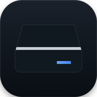

## Projects

<a href="https://github.com/itsmeares/staaash"><picture><source media="(prefers-color-scheme: dark)" srcset="assets/staaash-light.png"></picture></a>
<b><a href="https://github.com/itsmeares/staaash">Staaash ↗</a></b> 
File storage, management and sharing through web interface. Self-hosted alternative to Google Drive. 

## Stack

<b>Languages and web</b> 

<b>Data</b> 

<b>Infrastructure</b> 

<b>Tools</b> 

<b>Systems</b> 

## Activity

<a href="https://www.last.fm/user/itsmeares"><picture><source media="(prefers-color-scheme: dark)" srcset="https://raw.githubusercontent.com/itsmeares/itsmeares/live/activity-dark.svg"></picture></a>

<a href="https://github.com/itsmeares"><picture><source media="(prefers-color-scheme: dark)" srcset="https://raw.githubusercontent.com/itsmeares/itsmeares/live/graph-dark.svg"></picture></a>
